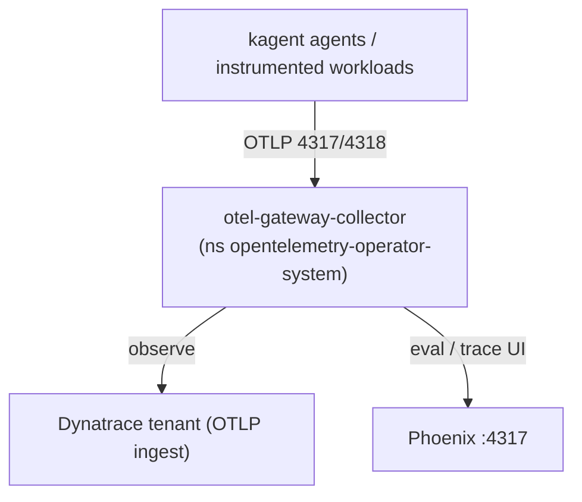

# 01 — Platform install

With the Codespace cluster running (module 00), install the observability +
agent platform. Everything lives under [`cluster/`](https://github.com/henrikrexed/dynatrace-AI-Agent-Workshop/tree/main/cluster)
and installs with one idempotent script.

!!! info "What gets installed"
    Dynatrace Operator (Kubernetes monitoring), OpenTelemetry Operator + a gateway
    collector, kagent (clean base — no agents yet), Tetragon (eBPF security),
    an Agent Sandbox isolation baseline, and Phoenix (LLM eval/trace UI).

## 1. Set your secrets

The install reads secrets from the environment (see
[SECRETS.md](https://github.com/henrikrexed/dynatrace-AI-Agent-Workshop/blob/main/.devcontainer/SECRETS.md)).
Set these as **Codespace secrets** and rebuild/restart:

| Secret | Used by |
|--------|---------|
| `DT_TENANT_URL` | Dynatrace Operator + OTLP export |
| `DT_API_TOKEN` | Dynatrace Operator + OTLP export |
| `LLM_API_KEY` *(or `OPENAI_API_KEY`)* | kagent model provider (needed in module 02) |

Missing secrets degrade gracefully — a component is skipped or warns, the install
never crashes.

## 2. Run the install

```bash
bash cluster/install.sh
```

Re-runnable any time (`helm upgrade --install` + `kubectl apply`). Skip a
component with, e.g., `INSTALL_DYNATRACE=false bash cluster/install.sh`.

## 3. Verify (acceptance)

```bash
kubectl get pods -A                                   # all operators/components Ready
kubectl get dynakube -n dynatrace                     # Dynatrace k8s monitoring
kubectl get otelcol -n opentelemetry-operator-system  # gateway collector
kubectl -n kagent get pods                            # kagent controller/ui/kmcp/db
kubectl -n tetragon get pods                          # Tetragon DaemonSet
kubectl -n phoenix get pods                           # Phoenix
```

Open **Phoenix** on the forwarded port `6006`. Open the **kagent UI** with:

```bash
kubectl -n kagent port-forward svc/kagent-ui 8080:8080
```

## How telemetry flows



The gateway normalises OpenInference/Traceloop LLM attributes to OpenTelemetry
`gen_ai.*` semconv so Dynatrace and Phoenix agree on names. There are **no agents
yet** — kagent is a clean base; module 02 deploys the SRE agent and the
BMAD crew, at which point spans start landing in both backends.

!!! note "BindPlane"
    BindPlane (OTel collector management) is **illustrated, not installed** — see
    the [walkthrough](https://github.com/henrikrexed/dynatrace-AI-Agent-Workshop/blob/main/cluster/otel/bindplane-illustrated.md).

## Troubleshooting

- **Tetragon not Ready** — eBPF/BTF on the Codespace kernel; see
  [`cluster/tetragon/README.md`](https://github.com/henrikrexed/dynatrace-AI-Agent-Workshop/blob/main/cluster/tetragon/README.md).
- **OTel operator hangs** — it must use its self-signed webhook cert
  (`autoGenerateCert`), already set in `otel/operator-values.yaml`.
- **No data in Dynatrace** — check `DT_TENANT_URL`/`DT_API_TOKEN` and token scopes
  (`openTelemetryTrace.ingest`, `metrics.ingest`, `logs.ingest`).
