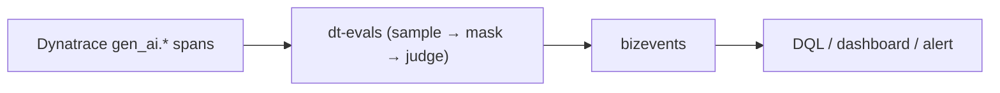

# 06 — Evaluate (Phoenix + dt-evals)

Observability (module 04) tells you *what the agent did* and *what it cost*. It
does **not** tell you whether the answer was correct, grounded, or useful. That's
**evaluation** — scoring agent outputs against expectations — and it's the step
most teams skip, which is why their agents quietly regress.

Both tools here evaluate the **same `gen_ai.*` spans** the OTel gateway already
produces (module 02/04) — you don't re-run the agents to grade them, you grade
the traces they already emitted:

- **Phoenix (Arize)** — interactive trace + eval UI, already running from
  module 01. You **build and run an LLM-as-a-judge evaluation in the UI** (no
  code) using the preconfigured DeepSeek judge — great for *exploratory* scoring.
- **dt-evals** — [`dynatrace-oss/dt-evals`](https://github.com/dynatrace-oss/dt-evals),
  the **primary** path: a config-driven CLI that pulls `gen_ai.*` spans from
  Dynatrace, scores them with a judge, and writes the results back as bizevents
  next to the rest of your telemetry.

Everything for this module lives under
[`evals/`](https://github.com/henrikrexed/dynatrace-AI-Agent-Workshop/tree/main/evals).
Both paths reuse the cost-efficient workshop judge — **DeepSeek** (`deepseek-chat`),
the same model that powers the agents — set once in `evals/.env`
(copy from `evals/.env.example`).

!!! warning "Generate traffic first"
    Evals score real traces. Drive the SRE agent or a BMAD task (module 02)
    **before** running either path, so there are spans to grade.

---

## Part A — Phoenix: create an evaluation in the UI

Phoenix is the fast, visual judge: you create **and** run an LLM-as-a-judge
evaluation entirely in the web UI — no code — scored by the same **DeepSeek**
model that powers the agents. Open Phoenix on the forwarded Codespace port
**6006**:

```bash
kubectl -n phoenix port-forward svc/phoenix 6006:6006
# then open http://localhost:6006
```

Every agent run shows up as an LLM trace: prompt, response, tool spans, token
counts. Click a span to see its `gen_ai.*` attributes. Module 04's gateway now
also surfaces each LLM call's prompt and completion as OpenInference
`input.value` / `output.value`, so the **Input** and **Output** are visible right
in the trace view — which is exactly what the judge reads.

!!! tip "The DeepSeek judge is already wired"
    The workshop's Phoenix is preconfigured for DeepSeek (`DEEPSEEK_API_KEY` is
    injected from your Codespace key, and `PHOENIX_ALLOWED_PROVIDERS=DEEPSEEK`
    restricts the model menu), so **DeepSeek is the only — and obvious — choice**
    everywhere you pick a judge model. You never hand-enter a key. If your Phoenix
    is *not* preconfigured, add the key once under **Settings → AI Providers →
    DeepSeek** and it behaves the same from there on.

### Create and run an LLM-as-a-judge (no code)

You'll score the SRE-agent traces from your last run against a judge classifier —
start with **hallucination** (is the answer grounded in the tool output it was
given?) or **relevance** (does it actually answer the question?).

1. **Pick the traces.** Open your project's **Traces** table and select the
   SRE-agent runs you want to grade (filter to the `agent.run` / LLM spans so each
   example carries a clean question → answer pair).
2. **Capture them as a dataset.** Use **Add to Dataset** to save the selected
   spans as a dataset — each example keeps the span's **Input** (the question) and
   **Output** (the agent's answer). This is the set the judge will score.
3. **Add an LLM evaluator.** Open the new dataset → **Evaluators** tab →
   **Add evaluator** → **LLM**. Phoenix opens it in the **Playground**:
     - **Model:** DeepSeek (the only provider in the menu — already keyed).
     - **Template:** write the judge prompt, e.g. *“You are grading whether the
       ANSWER is grounded in the provided CONTEXT/question. Reply with a single
       label: `hallucinated` or `factual`.”* (or a relevance rubric:
       `relevant` / `irrelevant`).
     - **Input mapping:** map the template's `{question}` / `{answer}` variables
       to the dataset's **input** / **output** fields.
     - **Test** it on one example to see the label + explanation, then **Save**.
4. **Run it.** From the dataset, **Run** an experiment in the Playground. Phoenix
   calls the DeepSeek judge **server-side** over every example — no local runtime.

### Read the scores

The experiment's results table gains one **label / score column per evaluator**.
Sort by it to surface the weakest answers, and click any row to read the judge's
**label, score, and explanation** next to that example's input and output. That is
your end-to-end eval — created, run, and read entirely in the Phoenix UI.

This is *exploratory*: fast, visual, good for discovering failure modes by hand.
For a repeatable gate you can run in CI, use dt-evals (Part B).

### Script the same judge instead (optional / advanced)

The UI flow above is the fast path. The repo also ships a small, version-pinned
script that builds the same two classifiers (**hallucination** + **relevance**)
from code — handy for CI, for grading the **live** spans in place, or when you
have no traffic yet:

```bash
cd evals && uv sync
# Bundled sample dataset — no cluster/traffic needed (just a judge key):
uv run python phoenix/run_phoenix_eval.py
# Live spans pulled from Phoenix, scores logged back onto the traces:
uv run python phoenix/run_phoenix_eval.py --from-phoenix
```

It prints a per-metric summary, writes `phoenix/out/phoenix_eval_results.csv`,
and (with `--from-phoenix`) annotates the originating spans so the labels show up
on the traces in the UI. Details: [`evals/phoenix/README.md`](https://github.com/henrikrexed/dynatrace-AI-Agent-Workshop/blob/main/evals/phoenix/README.md).

!!! note "`--from-phoenix` needs message content on the spans"
    The live path maps prompt/response content out of your spans in every common
    shape our agents emit — OTel GenAI semconv (`gen_ai.input.messages`, indexed
    `gen_ai.prompt.N.content` / `gen_ai.completion.N.content`, or `gen_ai.*`
    log-events) as well as OpenInference (`input.value` / `output.value` — the
    pair the gateway now also populates). If it still finds no content, it prints
    exactly which `attributes.*` were present so you can see what to add. The
    usual cause is instrumentation that **drops message bodies by default** —
    enable content capture and re-drive the agents (see the README). The bundled
    dataset path always works offline.

---

## Part B — dt-evals: trace-sourced evals in Dynatrace

[`dt-evals`](https://github.com/dynatrace-oss/dt-evals) is the **primary eval
path**. It samples `gen_ai.*` spans from your Dynatrace environment, masks PII,
scores each with an LLM judge, and writes `gen_ai.evaluation.result` **bizevents**
back — so a low score is one click from the trace, prompt, and tool calls that
caused it.



### 1. Credentials

dt-evals needs (put these in `evals/.env`). You created these during onboarding —
see
**[Start the benchmark → Create the required tokens](start-benchmark.md#4-create-the-required-tokens)**
for exact scopes and where each is generated:

| Var | What |
|-----|------|
| `DYNATRACE_API_TOKEN` | a **dedicated** `dt0c01` token with `storage:spans:read` + `storage:events:write` (not the module 01 OTLP token) — [token C](start-benchmark.md#c-dynatrace-dt-evals-token-dynatrace_api_token) |
| `DT_ENVIRONMENT_URL` | your `…apps.dynatrace.com` URL (derived from `DT_TENANT_URL` if unset) |
| `OPENAI_API_KEY` | judge key — a DeepSeek key works ([token D](start-benchmark.md#d-llm-deepseek-api-key-deepseek_api_key)) |
| `DT_EVAL_SERVICE` | the agent's `service.name` — **discover it, don't guess** |

Discover the service with DQL (Dynatrace Notebook):

```dql
fetch spans, from: now() - 2h
| filter isNotNull(gen_ai.operation.name) or isNotNull(gen_ai.request.model)
| summarize span_count = count(), by: { service.name }
| sort span_count desc
```

### 2. Run it

The CLI runs via `npx` (Node ≥ 22); the wrapper renders the config
([`evals/dt-evals/workshop-agents.dt-eval.yaml`](https://github.com/henrikrexed/dynatrace-AI-Agent-Workshop/blob/main/evals/dt-evals/workshop-agents.dt-eval.yaml))
with your env values and runs `validate` + `run`:

```bash
cd evals/dt-evals
./run-dt-eval.sh
```

The config enables agent-relevant metrics (relevance, faithfulness,
hallucination, coherence, toxicity, prompt-injection) and sets alert thresholds
that make the run **exit non-zero** on a breach — a ready-made CI gate.

### 3. Read the scores

```dql
fetch bizevents
| filter event.type == "gen_ai.evaluation.result"
| summarize avg(toDouble(gen_ai.evaluation.score.value)), by: { gen_ai.evaluation.name }
```

!!! tip "Shared vs per-attendee tenant"
    dt-evals reads spans **and** writes bizevents scoped by `service.name`. The
    workshop default is a **per-attendee Dynatrace tenant** (a free trial is
    enough) so nobody grades anyone else's traffic; a shared-tenant fallback with
    per-attendee `service.name` suffixes is documented in
    [`evals/dt-evals/README.md`](https://github.com/henrikrexed/dynatrace-AI-Agent-Workshop/blob/main/evals/dt-evals/README.md#tenant-model-74).

---

## Part C — grade a *diagnosis* against the answer key

Parts A/B judge generic quality (grounded? relevant? toxic?). The **diagnostic
module** ([05 — Diagnose](05-diagnose.md)) asks a sharper question: when the SRE
agent investigates a *real* injected fault, **did it reach the right root
cause?** Each scenario ships an objective answer key —
`scenarios/<id>/expected-diagnosis.md` — and those keys are **registered as this
module's diagnosis-grading ground truth** under
[`evals/ground-truth/`](https://github.com/henrikrexed/dynatrace-AI-Agent-Workshop/tree/main/evals/ground-truth).

The grading check:

> Did the diagnosis cite **≥ `pass_threshold`** of the answer key's required
> signals (root cause + evidence channel), identify the root cause, and avoid the
> forbidden cross-channel claims?

Because scenarios 01–03 sit on **distinct evidence channels** (logs vs. events vs.
`OOMKilled` status), a cross-channel claim is an unambiguous fail — so this grades
objectively, even with no judge model.

### Deterministic grade (offline, no key)

```bash
cd evals
python phoenix/run_diagnosis_eval.py        # bundled golden + confab diagnoses
```

It prints a PASS/FAIL per diagnosis and writes
`phoenix/out/diagnosis_eval_results.csv`. Add `--llm-judge` (needs a judge key) to
also run an LLM root-cause grader, or `--from-phoenix` to grade the agent's *live*
diagnosis spans and annotate them back onto the traces.

### In Dynatrace (dt-evals)

Each answer key is also rendered into a dt-evals custom evaluator. Register the
one for the scenario you ran, then grade its spans:

```bash
cd evals/dt-evals
npx -y "$DT_EVALS_PKG" evaluators add            # paste evaluators/diagnosis-<id>.md
./run-dt-eval.sh --config scenario-diagnosis.dt-eval.yaml --metric diagnosis-<id>
```

Correct diagnoses score 1, misses score 0 — a per-scenario pass/fail bizevent next
to the trace. Details:
[`evals/ground-truth/README.md`](https://github.com/henrikrexed/dynatrace-AI-Agent-Workshop/blob/main/evals/ground-truth/README.md).

!!! tip "Closing the diagnose → evaluate → optimize loop"
    The same diagnosis runs you grade here emit the `gen_ai.*` spans whose
    token/cost/latency drive **[07 — Optimize](07-optimize.md)**. Break it
    ([05 — Diagnose](05-diagnose.md)), grade it (06), cut the waste (07).

---

## What to measure for *these* agents

| Agent | Good eval questions |
|-------|---------------------|
| **SRE agent** | Did it correctly identify the unhealthy pod? Did it call the right k8s/Dynatrace tool (not guess)? Was the diagnosis grounded in real tool output (no hallucinated pod names)? |
| **BMAD crew** | Did the workflow produce the expected artifacts (issues → branch → PR)? Did the developer agent stay within its repo scope? Did it finish within a token budget? |

## What you achieved (acceptance)

- A Phoenix eval run produces labelled scores you can inspect in the UI (or the
  CSV) — even offline against the bundled dataset.
- A dt-evals run scores the agents' real traces and lands the results in
  Dynatrace as queryable bizevents, with a CI-friendly pass/fail gate.
- A diagnosis-grading run (Part C) scores an SRE-agent diagnosis against a
  scenario answer key — PASS/FAIL against registered ground truth, offline or in
  Dynatrace.

Next: **[07 — Optimize](07-optimize.md)** — now that you can *measure* cost and
quality, go cut the waste.
