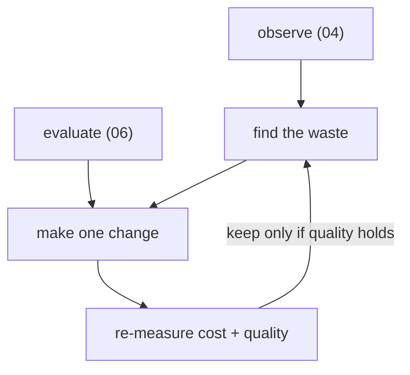

# 07 — Optimize

This is where the whole workshop pays off. You can now **run** agents (02),
**secure** them (03), **observe** their cost (04), and **evaluate** their quality
(06). Optimization is the loop that uses that evidence to make agents **cheaper
without making them worse**.

!!! quote "The core idea"
    The biggest driver of AI agent cost is **tokens** — and most token spend is
    waste: unused tools inflating every prompt, oversized system prompts, chatty
    multi-hop workflows, and retries. You can't cut what you can't see, which is
    why observation and evaluation came first.

## The optimization loop



Change one thing, re-run the eval suite, and keep the change **only if quality
holds and cost dropped**. Never optimize on cost alone — that's how you ship a
cheap agent that gives wrong answers.

!!! tip "Two ready-made surfaces — deploy them first"
    This module ships a Dynatrace **dashboard** and **notebook** that compute every
    signal below from your crew's `gen_ai.*` spans. Deploy them, then read the rest
    of this page with your own data on screen:

    ```bash
    dtctl config use-context <your-tenant>
    cd cluster/dynatrace/optimization
    dtctl apply -f ai-agent-optimization.dashboard.yaml
    dtctl create notebook -f ai-agent-optimization-before-after.notebook.yaml
    ```

    - **Dashboard** — *AI Agent Optimization*: spend ranking, input:output ratio,
      tools-actually-used, loop detection, token-trend.
    - **Notebook** — *AI Agent Optimization — before/after*: the observe → find →
      change → re-measure → keep/revert walkthrough, one runnable DQL cell per step.

    All four artifacts (dashboard, notebook, guardian, workflow — §4) are
    dtctl-ready YAML in [`cluster/dynatrace/optimization/`](https://github.com/henrikrexed/dynatrace-AI-Agent-Workshop/tree/main/cluster/dynatrace/optimization) with a README.

## 1. Rank your agents by spend

From Dynatrace AI Observability (module 04), find your most expensive agents —
total tokens and estimated cost per run. Start at the top of that list; a 20%
cut on your priciest agent beats a 50% cut on a rarely-used one.

```
fetch spans
| filter service.namespace == "kagent" and isNotNull(gen_ai.usage.output_tokens)
| summarize llmCalls = count(),
    inputTokens  = sum(gen_ai.usage.input_tokens),
    outputTokens = sum(gen_ai.usage.output_tokens),
    by:{agent = service.name}
| fieldsAdd totalTokens = inputTokens + outputTokens,
    inOutRatio      = round(toDouble(inputTokens) / outputTokens, decimals: 1),
    avgInputPerCall = round(toDouble(inputTokens) / llmCalls)
| sort totalTokens desc
```

!!! example "What this looked like on the reference tenant (7-day window)"
    | Agent | Total tokens | in:out ratio | Avg input / call |
    |-------|---:|:---:|---:|
    | `seta_sre_investigator` | 46.2 M | **38 : 1** | **33,180** |
    | `bmad_orchestrator` | 11.8 M | 14 : 1 | 8,762 |
    | `bmad_developer` | 2.7 M | 3 : 1 | 6,191 |

    The whole crew burned **64 M tokens**, and one agent — the SRE investigator —
    is **72%** of it. Note the **input : output ratio**: 38 input tokens for every
    output token means the model re-reads a large context on *every* call. That
    ratio, not the raw total, is your waste compass. Start there.

## 2. The four highest-leverage cuts

### a) Remove tools the agent never uses

Every tool an agent is granted is described in **every** prompt sent to the
model — that's input tokens on every single call, whether the tool is used or
not. In the traces, look at which tools an agent *actually* calls over many runs;
anything never called is pure overhead.

Trim the agent's `toolNames` to only what it uses:

```yaml
# agents/sre/sre-agent.yaml (illustrative)
spec:
  tools:
    - type: McpServer
      mcpServer:
        toolNames:        # ← keep only the tools this agent actually calls
          - list_pods
          - get_logs
          - dql_query
          # dropped: a dozen k8s tools the SRE agent never invoked
```

List the tools each agent *actually* calls straight from the traces (grouped by
agent so you see the whole crew at once), then diff against each agent's granted
set:

```
fetch spans
| filter service.namespace == "kagent"
    and gen_ai.operation.name == "execute_tool" and gen_ai.tool.name != "(merged tools)"
| summarize calls = count(), by:{agent = service.name, tool = gen_ai.tool.name}
| sort agent asc, calls desc
```

!!! example "Measure the schema tax directly"
    Each tool is a JSON schema injected into every prompt. On the reference
    tenant one captured `call_llm` request carried **7** tool declarations costing
    **~1,160 input tokens** — about **165 tokens per tool, on every call**. The
    shipped SRE agent (`agents/sre/sre-agent.yaml`) attaches the built-in
    `kagent-tool-server` with **no `toolNames` filter**, so every discovered k8s
    and networking tool rides along — far more than a diagnosis actually calls.
    Pin `toolNames` to the handful the traces prove it uses and you reclaim those
    tokens on all 1,357 calls — before touching anything else.

Re-apply (`bash agents/install-agents.sh`), send the same prompts, and compare
input-token counts in Dynatrace. Fewer tools → smaller prompts → lower cost on
*every* call.

#### Tool-coverage lookup — the never-called tools, by name

The query above lists the tools an agent *did* call. The optimization you want
is the **complement**: which granted tools did it **never** call? Those are the
pure-overhead schemas to drop first. Left-join the agent's *granted* tool set
against the tools it actually called, so zero-call tools surface explicitly.

The granted set ships as a lookup table —
[`cluster/dynatrace/optimization/tool-grants.lookup.json`](https://github.com/henrikrexed/dynatrace-AI-Agent-Workshop/tree/main/cluster/dynatrace/optimization/tool-grants.lookup.json) —
generated from the agents' `toolNames`. The query below embeds the SRE agent's
15 granted tools inline via `data record(...)` (so it's self-contained) and
`lookup`s the traces for each tool's call count; `coalesce(..., 0)` turns a
never-called tool into a `0`, and the `verdict` column flags the drop candidates:

```
data record(tool = "k8s_get_resources"),
     record(tool = "k8s_describe_resource"),
     record(tool = "k8s_get_resource_yaml"),
     record(tool = "k8s_get_pod_logs"),
     record(tool = "k8s_get_events"),
     record(tool = "k8s_get_available_api_resources"),
     record(tool = "k8s_get_cluster_configuration"),
     record(tool = "k8s_check_service_connectivity"),
     record(tool = "k8s_apply_manifest"),
     record(tool = "k8s_patch_resource"),
     record(tool = "k8s_scale"),
     record(tool = "k8s_rollout"),
     record(tool = "k8s_label_resource"),
     record(tool = "k8s_annotate_resource"),
     record(tool = "k8s_execute_command")
| lookup [
    fetch spans
    | filter service.namespace == "kagent"
        and service.name == "seta_sre_investigator"
        and gen_ai.operation.name == "execute_tool"
        and gen_ai.tool.name != "(merged tools)"
    | summarize calls = count(), by:{tool = gen_ai.tool.name}
  ], sourceField:tool, lookupField:tool, prefix:"called_"
| fieldsAdd calls = coalesce(called_calls, 0)
| fieldsAdd verdict = if(calls == 0, "NEVER CALLED — drop candidate", else: "used")
| fieldsRemove called_tool, called_calls
| sort calls asc
```

The `service.name == "seta_sre_investigator"` filter here is **intentional**:
coverage is a per-agent question ("which of *this* agent's granted tools did
*this* agent never call"). To cover another agent, swap the service name and the
`data record(...)` block for that agent's rows from the lookup file. The
dashboard's **Tool coverage** tile and the notebook's **tool-coverage** cell run
exactly this query.

!!! tip "Tool-call count is the headline"
    The dashboard's top row carries a **Tool calls** single-value tile (total
    `execute_tool` spans) right next to LLM calls — so the never-/rarely-used
    angle is visible before you even scroll. A tool with **zero** calls in the
    coverage table is an unconditional drop; a tool with a handful of calls on a
    large sample is a *rarely-used* candidate worth questioning.

### b) Tighten the system prompt

A rambling system prompt is a fixed tax on every request. Shorten it to the
essentials; move examples out unless they measurably improve the eval score.

### c) Fix chatty workflows

In a BMAD run, the span waterfall (module 04) shows how many A2A hops and LLM
calls a task took. Redundant hand-offs, an agent that re-reads context it already
has, or a loop that retries silently all show up as extra `gen_ai` spans. Collapse
the hops that don't earn their tokens.

```
fetch spans
| filter service.namespace == "kagent" and isNotNull(gen_ai.usage.input_tokens)
| summarize llmCalls = count(), inputTokens = sum(gen_ai.usage.input_tokens),
    by:{agent = service.name, task = gen_ai.task.id}
| filter llmCalls >= 5
| sort inputTokens desc
```

!!! example "Loops are where big agents actually bleed"
    On the reference tenant the SRE investigator's heaviest task made **7
    `call_llm` hops and re-sent 228,000 input tokens** — the same growing context
    pushed to the model again and again. For an already-lean agent (few tools,
    tight prompt) this loop re-send, *not* unused tools, is the dominant cost. The
    dashboard's **loop table** ranks these so you fix the worst first.

### d) Right-size the model per agent

Not every agent needs the most capable model. kagent makes the model a
one-line `ModelConfig` reference, so you can point a cheap, mechanical agent
(e.g. a formatter) at a smaller/cheaper model while the reasoning-heavy
orchestrator keeps the stronger one. This workshop already defaults the whole
crew to **DeepSeek** for cost; per-agent tuning goes further.

```yaml
# agents/mcp/00-modelconfig.yaml — the shared workshop-llm (DeepSeek, cost-first)
# Create a second, cheaper ModelConfig and reference it from the agents that
# don't need the strong model. One field per agent: spec.modelConfig.
```

## 3. Prove the win

Open the **before/after notebook** (deployed above). Its §5 cell measures the one
number that moves — average input tokens per LLM call, **per agent** — and the
section time-picker is how you switch the *before* and *after* windows. Read the
row for the agent you changed and compare it across the two windows:

```
fetch spans
| filter service.namespace == "kagent" and isNotNull(gen_ai.usage.input_tokens)
| summarize llmCalls = count(),
    avgInputPerCall    = round(avg(gen_ai.usage.input_tokens)),
    medianInputPerCall = round(median(gen_ai.usage.input_tokens)),
    totalInputTokens   = sum(gen_ai.usage.input_tokens), by:{service.name}
| sort avgInputPerCall desc
```

The procedure, in order:

1. Run the query over a window *before* the change — record `avgInputPerCall`.
2. Make **one** change (trim tools / tighten prompt / collapse hops / right-size model).
3. Re-apply and replay the **same** prompts.
4. Run the query over the *after* window and run the dt-evals suite (module 06).

Fill the scorecard from those two runs:

| Metric | Before | After | Keep? |
|--------|:---:|:---:|:---:|
| Avg input tokens / call | *(§5 notebook)* | *(§5 notebook)* | — |
| Est. cost / task | — | — | — |
| Eval pass rate | *(module 06)* | *(module 06)* | ✅ only if ≥ before |

!!! success "The rule"
    Ship the change when **cost went down and the eval pass rate did not**. If
    quality dropped, revert — the cheaper agent that's wrong is more expensive
    than the costly one that's right.

## 4. Make it continuous — the guardian + workflow

Optimization isn't a one-off. Because cost and quality are now both telemetry,
the workshop ships two more dtctl-ready artifacts in
[`cluster/dynatrace/optimization/`](https://github.com/henrikrexed/dynatrace-AI-Agent-Workshop/tree/main/cluster/dynatrace/optimization)
that turn the optimization loop into an automated gate:

**A Site Reliability Guardian** (`ai-agent-quality-cost.guardian.yaml`) — three
DQL objectives over the crew's `call_llm` spans, so a regression fails loudly:

| Objective | SLI | Rule | target / warning |
|-----------|-----|------|------------------|
| Cost per LLM call | avg input tokens / call | `≤` | 20,000 / 18,000 |
| Loop efficiency | avg hops / task | `≤` | 5 / 4 |
| Answer substance (quality proxy) | avg output tokens / call | `≥` | 200 / 300 |

```bash
dtctl create settings -f ai-agent-quality-cost.guardian.yaml \
  --schema app:dynatrace.site.reliability.guardian:guardians --scope environment
```

The quality proxy backstops the cost cuts — an agent that got "cheaper" by
emitting truncated answers trips it. For the full **LLM-judge** quality gate,
pair the guardian with the dt-evals suite (module 06).

**A scheduled Workflow** (`ai-agent-optimization.workflow.yaml`) runs that
guardian daily over the last 24h (schedule ships disabled — flip
`trigger.schedule.isActive: true` to go continuous):

```bash
dtctl create workflow -f ai-agent-optimization.workflow.yaml
```

Beyond the guardian:

- Keep the dt-evals suite in CI as a **regression + budget gate** on every agent
  change.
- Watch the dashboard's **token-trend** tile; the guardian alerts when an
  agent's tokens-per-call drifts up.
- Re-rank your agents periodically — usage patterns change, and today's cheap
  agent is tomorrow's top spender.

## What you achieved (acceptance)

- You identified the most expensive agents from real telemetry.
- You applied at least one concrete cut (unused tools / prompt / hops / model)
  and **proved** with evals that quality held while cost fell.
- You have a repeatable loop — observe → evaluate → change → re-measure — to keep
  agents cost-efficient in production.

## You've completed the arc

**Why → kagent → cluster → agents → secure → observe → diagnose → evaluate → optimize.**
You built a full, cost-efficient AI-agent platform on Kubernetes and have the
telemetry and evals to keep it that way.

Stuck on anything? See **[Troubleshooting](troubleshooting.md)**.
