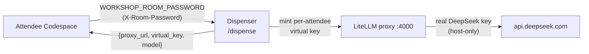

# Host runbook (facilitator)

> **Audience:** the person *running* the workshop (Henrik), not attendees.
> Attendees never see the proxy — they supply only a **room password**
> (`WORKSHOP_ROOM_PASSWORD`) and everything else is dispensed for them.

This page is the pre-session / post-session checklist for the **shared model
proxy** that backs the room-password flow. Attendees reach DeepSeek through a
LiteLLM proxy; the real provider key lives **only** on the proxy host, and each
attendee is handed a per-attendee, budget-capped virtual key at Codespace
startup. The attendee-facing side of this is token **D** on
[Start the benchmark](start-benchmark.md#4-create-the-required-tokens).

!!! info "Where the proxy lives"
    The proxy, the dispenser, and their exact operational scripts (systemd units,
    the `revoke-all` helper, key-mint budgets) are provisioned from the **private
    `proxmox-clusters` repo** (ISI-6994 / ISI-6995). This runbook gives the
    operational *sequence*; that repo is the authoritative source for the exact
    commands and host-specific values. **Never** put the LiteLLM master key or the
    raw DeepSeek key in this (public) repo.

## How the flow hangs together



- The dispenser is exposed publicly over **Tailscale Funnel** (HTTPS) at the URL
  baked into
  [`dispense-llm.sh`](https://github.com/henrikrexed/dynatrace-AI-Agent-Workshop/blob/main/.devcontainer/bootstrap/dispense-llm.sh)
  (`WORKSHOP_DISPENSER_URL`, default `https://litellm-proxy.<tailnet>.ts.net/dispense`).
- A valid **room password** → the dispenser mints a fresh, budget-capped virtual
  key scoped to the single `deepseek-chat` model and returns the proxy endpoint +
  key. The attendee's bootstrap writes them to the gitignored `.workshop-llm.env`.
- Budget per key is capped (≈ **$4**), so a runaway attendee hits a `429` instead
  of your bill.

---

## Before the session

Do this shortly **before** attendees start (ideally < 1 h before, so the password
window is tight):

1. **Confirm the real provider key is loaded on the host — and only there.**
   The LiteLLM proxy reads the real DeepSeek key from its own environment on the
   proxy host (never from this repo). Verify the proxy is healthy:
   ```bash
   # on the proxy host
   systemctl status litellm.service          # proxy up on :4000
   systemctl status litellm-dispenser.service # dispenser up on :8080
   ```
2. **Rotate the room password.** Set a fresh `WORKSHOP_ROOM_PASSWORD` on the
   dispenser and restart it so the old password stops minting keys:
   ```bash
   # on the proxy host — set the new password in the dispenser's env, then:
   sudo systemctl restart litellm-dispenser.service
   ```
   Pick a new string each session. (Exact env-file path is in the
   `proxmox-clusters` repo.)
3. **Start / verify the Funnel** so attendees can reach the dispenser from their
   Codespaces:
   ```bash
   tailscale funnel status        # is /dispense published on 443?
   # if not running:
   sudo tailscale funnel --bg 4000   # (or the dispenser port per proxmox-clusters)
   ```
4. **Smoke-test the dispenser end to end** with the new password (this is exactly
   what each attendee's `dispense-llm.sh` does):
   ```bash
   curl -sS -H "X-Room-Password: <new-password>" \
     https://litellm-proxy.<tailnet>.ts.net/dispense
   # expect 200 {"proxy_url":"https://…","virtual_key":"sk-…","model":"deepseek-chat"}
   ```
5. **Hand the room password to attendees** (chat / slide / landing page). That is
   the *only* model credential they need — they set it as the
   `WORKSHOP_ROOM_PASSWORD` Codespace secret (token **D**).

!!! tip "If an attendee's agents have no model key"
    Have them re-run `bash .devcontainer/bootstrap/dispense-llm.sh` and then
    re-run `bash cluster/install.sh`. The usual cause is a wrong/stale room
    password (dispenser returns `401`) or the Funnel being down (returns `000` /
    unreachable).

---

## After the session (teardown)

Tear down in this order so no attendee key keeps spending and the public surface
is closed:

1. **Revoke the minted virtual keys** — stops all attendee spend immediately:
   ```bash
   # on the proxy host — the revoke-all helper shipped with the dispenser (ISI-6995)
   ./revoke-all.sh        # blocks/deletes every minted virtual key via the master key
   ```
2. **Stop the Funnel** — closes the public dispenser endpoint:
   ```bash
   sudo tailscale funnel reset     # or: sudo tailscale funnel --bg 4000 off
   tailscale funnel status         # confirm nothing is published
   ```
3. **Destroy the proxy LXC** — if you spun it up just for this session:
   ```bash
   # on the Proxmox node
   pct stop <ctid> && pct destroy <ctid>   # e.g. the litellm-proxy container
   ```
   (Skip this if you keep the container around between sessions — in that case
   just leave it stopped, keys revoked and Funnel down.)

!!! warning "Order matters"
    **Revoke keys → stop Funnel → destroy LXC.** Revoking first guarantees spend
    stops even if teardown is interrupted; closing the Funnel before destroying the
    host avoids leaving a dangling public endpoint pointing at nothing.

---

## Cost guardrails at a glance

- Per-attendee virtual key budget: **≈ $4** (hard cap → `429` when exceeded).
- Planning ceiling used for the design: ~60 attendees × 2 sessions ≈ **$240**
  (ISI-6992, decision D2).
- The proxy only allows the single `deepseek-chat` model — any other model name is
  rejected `400`, so a leaked key can't be repurposed for a pricier model.

## See also

- [Start the benchmark → token **D**](start-benchmark.md#4-create-the-required-tokens) — the attendee-facing room-password step.
- [`.devcontainer/SECRETS.md`](https://github.com/henrikrexed/dynatrace-AI-Agent-Workshop/blob/main/.devcontainer/SECRETS.md) — the full secret contract and the `WORKSHOP_DISPENSER_URL` override.
- Private `proxmox-clusters` repo — the proxy/dispenser install, systemd units, and `revoke-all` script (authoritative commands).
