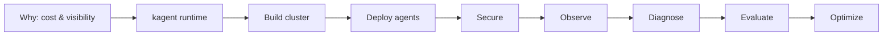

# Dynatrace AI Agent Workshop

AI agents are evolving fast, but many organizations still struggle with rising
costs, limited visibility, and unreliable performance in production.

In this hands-on workshop you'll design, deploy, and optimize **cost-efficient AI
agent workflows** using **BMAD, kagent, Kubernetes, and Dynatrace AI
Observability** — all from a single GitHub Codespace.

## What you'll learn

- Control the biggest driver of AI agent costs.
- Build structured multi-agent workflows with BMAD.
- Deploy AI agents on Kubernetes using kagent.
- Secure agents with Tetragon and Agent Sandbox.
- Monitor cost, performance, and efficiency with Dynatrace AI Observability.
- Evaluate agents with Phoenix + dt-evals, then optimize the inefficient ones.

## Workshop arc

1. **Why** — cost, visibility, reliability of AI agents in production.
2. **kagent intro** — the agentic runtime on Kubernetes.
3. **Build the cluster** (Codespace).
4. **Deploy two agent sets** — an SRE agent + the BMAD software-building crew.
5. **Secure agents** — Tetragon runtime security + Agent Sandbox.
6. **Observe** — Dynatrace AI Observability.
7. **Diagnose** — inject a fault, let the agent find the root cause.
8. **Evaluate** — Phoenix (Arize) + dt-evals.
9. **Optimize** — find unused tools/skills and cut token spend.

## Start here

New to kagent? Read **[kagent in 5 minutes](kagent-explainer.md)** for the mental
model, then head to **[00 — Setup (Codespace)](00-setup.md)** to boot your
environment. The modules run in order:

1. [kagent in 5 minutes](kagent-explainer.md) — the runtime, in one page.
2. [00 — Setup (Codespace)](00-setup.md) — boot the cluster.
3. [01 — Platform install](01-platform-install.md) — operators, kagent, Tetragon, Phoenix.
4. [02 — Agents & MCP wiring](02-agents-mcp.md) — deploy the SRE agent + BMAD crew.
5. [03 — Secure agents](03-secure.md) — Tetragon + Agent Sandbox.
6. [04 — Observe with Dynatrace](04-observe.md) — cost, tokens, latency.
7. [05 — Diagnose a broken cluster](05-diagnose.md) — inject a fault, let the agent find the root cause.
8. [06 — Evaluate (Phoenix + dt-evals)](06-evaluate.md) — score quality + cost.
9. [07 — Optimize](07-optimize.md) — cut the waste, keep the quality.

Running the live demo? The **[Run of show (guided demo)](run-of-show.md)** stitches
these modules into one top-to-bottom 13-step script — configure an agent, investigate
the cluster, turn on observability, evaluate, and optimize — with a link back to each
module for the depth behind every step.

Stuck anywhere? The [Troubleshooting](troubleshooting.md) page collects the
common fixes per module.

> This site is built with MkDocs Material and served from the Codespace on
> forwarded port **8000** (`mkdocs serve -a 0.0.0.0:8000`).
