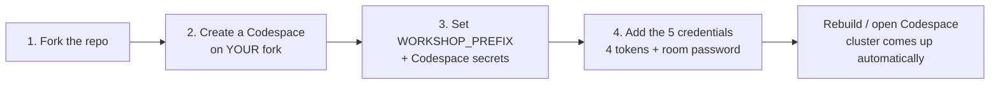

# Start the benchmark

This is the **front door** to the workshop. Follow it top to bottom and you go
from nothing to a running cluster with every token in place — without reading any
other page first. It is also the **single source of truth for secrets**: every
later module links back here instead of re-listing tokens.

The whole path is four steps:



You will need accounts on two services before you start:

- **GitHub** (free) — to fork and run the Codespace.
- **Dynatrace** — a tenant you can create tokens in. A free
  [Dynatrace trial](https://www.dynatrace.com/signup/) works.

You do **not** need a DeepSeek (or any model-provider) account. The agents, the
Phoenix evals, and the dt-evals judge all reach the model through the workshop's
hosted proxy — your host gives you a single **room password** that unlocks it,
which you set as `WORKSHOP_ROOM_PASSWORD` in Step 3 (token **D** below).

---

## 1. Fork the repo

Create your own copy of the workshop repository under your GitHub account.

1. Open the workshop repo:
   [`henrikrexed/dynatrace-AI-Agent-Workshop`](https://github.com/henrikrexed/dynatrace-AI-Agent-Workshop).
2. Click **Fork** (top-right) → **Create fork**. Keep the default name.

You now have `your-username/dynatrace-AI-Agent-Workshop`. Everything below
happens on **your fork**, never on the upstream repo.

!!! info "Why fork?"
    The published workshop site and the demo write-back (issues/PRs the BMAD crew
    creates) run against **your** repository. Working on a fork keeps your tokens,
    your Codespace secrets, and your GitHub Pages copy entirely under your own
    account.

New to forks? See GitHub's
[Fork a repo](https://docs.github.com/en/pull-requests/collaborating-with-pull-requests/working-with-forks/fork-a-repo)
guide.

---

## 2. Create a Codespace on your fork

The devcontainer installs the full toolchain (`kubectl`, `helm`, `kind`,
`kagent`, `uv`, `mkdocs`, …) and, on create, builds a local Kubernetes cluster
automatically.

1. On **your fork** (`your-username/dynatrace-AI-Agent-Workshop`), click
   **Code → Codespaces → Create codespace on `main`**.
   - Make sure the repository shown is your fork, **not** `henrikrexed/…`.
2. **Machine type:** choose **4-core / 16 GB** or larger. The default
   2-core / 4 GB is **not** enough for the full stack.

!!! tip "Set the secrets first (Step 3) — it saves a rebuild"
    Codespace secrets are injected at container start. If you create the
    Codespace before adding them, add the secrets, then run
    **Codespaces: Rebuild Container** so the values are picked up.

!!! warning "Pick your `WORKSHOP_PREFIX` — it's REQUIRED and asked for up front"
    This is a **shared Dynatrace tenant**: every attendee's agents, clusters, and
    telemetry land in the same environment. `WORKSHOP_PREFIX` is your personal
    isolation label — it stamps your namespaces, your agents'
    `service.name` (`<prefix>-sre-agent`), and the `workshop.attendee` /
    `k8s.cluster.name` on every signal, so the dashboards, evals, and DQL you run
    only show **your** data. The **Create codespace with options…** dialog prompts
    for it alongside the secrets below. It is **fail-closed** — if it is unset or
    invalid the bootstrap stops rather than render unscoped. Pick a lowercase label
    that starts with a letter, 2–19 chars of `a-z 0-9 -` (e.g. `team-alpha`), and
    keep it to yourself. You set it once at create; everything downstream resolves
    from it automatically.

---

## 3. Add your Codespace secrets

Set the tokens from Step 4 as **Codespace secrets** so they are injected as
environment variables — never committed to git.

1. Go to GitHub **Settings → Codespaces → Secrets**
   ([github.com/settings/codespaces](https://github.com/settings/codespaces)),
   or your fork's **Settings → Secrets and variables → Codespaces** for a
   repo-scoped secret.
2. For each secret in the table below, click **New secret**, paste the value,
   and **scope it to your fork** (`your-username/dynatrace-AI-Agent-Workshop`).
3. After adding or rotating a secret, **rebuild or restart** the Codespace.

GitHub only prompts for the declared variables in the *Create codespace with
options…* dialog; you can also set them any time from the Codespaces secrets
page above. Reference: GitHub's
[account-specific Codespaces secrets](https://docs.github.com/en/codespaces/managing-your-codespaces/managing-your-account-specific-secrets-for-github-codespaces).

| Secret | Required | What it is |
|--------|:---:|---------|
| `WORKSHOP_PREFIX` | ✅ | Your shared-tenant isolation prefix. **Not a token** — a lowercase label (start with a letter, 2–19 chars of `a-z 0-9 -`, e.g. `team-alpha`). Fail-closed: the bootstrap stops without it. See the warning in Step 2. |
| `DT_TENANT_URL` | ✅ | Dynatrace tenant URL, e.g. `https://abc12345.live.dynatrace.com`. |
| `DT_API_TOKEN` | ✅ | Dynatrace **ingest** token (traces/metrics/logs) — OTLP export + DynaKube `dataIngestToken`. See token **A** below. |
| `DT_PLATFORM_TOKEN` | ✅ | Dynatrace **platform** token (`dt0s16`) for `dtctl` — token **B**. |
| `DYNATRACE_API_TOKEN` | ✅ | Dynatrace **operator + dt-evals** token — the DynaKube `apiToken` (Kubernetes-monitoring scopes) **and** the Phase-4 dt-evals token. See token **C**. Distinct from `DT_API_TOKEN`. |
| `WORKSHOP_ROOM_PASSWORD` | ✅ | The workshop **room password** from your host — the only model credential you supply. Unlocks the hosted proxy that powers the agents *and* the Phoenix / dt-evals judge. See token **D** below. |
| `GH_PAT` | ✅ | GitHub fine-grained PAT for the demo write-back — token **E**. |
| `GH_DEMO_REPO` | ✅ | The demo repo the GitHub MCP writes to, as `owner/repo` (e.g. `your-username/bad-crew-demo`). |
| `DT_ENVIRONMENT` | optional | Dynatrace **apps** URL (`https://<env>.apps.dynatrace.com`). Derived from `DT_TENANT_URL` if unset. |

Verify presence once the Codespace is up (values are never printed):

```bash
bash .devcontainer/bootstrap/check-secrets.sh
```

---

## 4. Create the required tokens

Five credentials power the workshop. Four are Dynatrace / GitHub tokens you
**create** with **exactly** the permissions below — over-scoping is a security
risk, under-scoping breaks a module. The fifth (**D**, the room password) you
simply **receive from your host** — there is nothing to generate.

### A. Dynatrace ingest token → `DT_API_TOKEN`

Used by the OpenTelemetry collector to ingest the agents' traces, metrics, and
logs into Dynatrace, and reused as the DynaKube `dataIngestToken`. **Ingest scopes
only** — the DynaKube *operator* uses a separate token (`DYNATRACE_API_TOKEN`,
token **C**).

- **Type:** API token (`dt0c01`) **or** platform token (`dt0s16`).
- **Scopes (ingest):**
    - classic `dt0c01`: `openTelemetryTrace.ingest` · `metrics.ingest` · `logs.ingest`
    - platform `dt0s16`: `openpipeline:traces:ingest` · `openpipeline:logs:ingest` · `data-acquisition:metrics:ingest` · `data-acquisition:logs:ingest`
- **Create it:** in your Dynatrace environment, open **Access Tokens**
  (`https://<your-env>.apps.dynatrace.com/ui/apps/dynatrace.classic.tokens`) →
  **Generate new token** → select the ingest scopes.
- **Docs:** [Dynatrace access tokens](https://docs.dynatrace.com/docs/manage/identity-access-management/access-tokens-and-oauth-clients/access-tokens).

### B. Dynatrace platform token → `DT_PLATFORM_TOKEN`

Used by the `dtctl` CLI in the optimization module (module 07) to push the
dashboard, notebook, Site Reliability Guardian, and workflow to your tenant.

- **Type:** platform token, prefix `dt0s16`.
- **Create it:** at
  [**My platform tokens**](https://myaccount.dynatrace.com/platformTokens) →
  **Generate token**. The token inherits your user's platform permissions.
- **Docs:** [Dynatrace platform tokens](https://docs.dynatrace.com/docs/manage/identity-access-management/access-tokens-and-oauth-clients/platform-tokens).

!!! note "Three distinct Dynatrace tokens"
    `DT_PLATFORM_TOKEN` (`dtctl`) is **not** the same as `DT_API_TOKEN`
    (ingest) or `DYNATRACE_API_TOKEN` (DynaKube operator + dt-evals). They
    authenticate against different Dynatrace surfaces — keep all three separate.

### C. Dynatrace operator + dt-evals token → `DYNATRACE_API_TOKEN`

This token does two jobs: it is the **DynaKube operator** token (the `apiToken`
the Dynatrace Operator uses to stand up the ActiveGate and monitor the cluster)
**and** the **dt-evals** token (Phase 4 — reads agent spans, writes eval results).
It is a **separate** token from the ingest one (`DT_API_TOKEN`).

- **Type:** API token (`dt0c01`) **or** platform token (`dt0s16`).
- **Scopes:** the Kubernetes-monitoring scopes **and** the dt-evals scopes:
    - **Kubernetes monitoring (operator / ActiveGate)** — classic: `activeGateTokenManagement.create` · `entities.read` · `settings.read` · `settings.write`; platform: `fleet-management:activegate.tokens:create` · `fleet-management:activegate.connection-info:read` · `settings:objects:read` · `settings:objects:write`
    - **dt-evals** — `storage:spans:read` · `storage:events:write`
- **Create it:** same **Access Tokens** page as token **A**, selecting the scopes above.
- **Docs:** [Dynatrace access tokens](https://docs.dynatrace.com/docs/manage/identity-access-management/access-tokens-and-oauth-clients/access-tokens).

!!! warning "Wrong token in `DYNATRACE_API_TOKEN` is the #1 DynaKube failure"
    If `kubectl get dynakube -n dynatrace` shows **`Error`** with conditions like
    `ActiveGateConnectionInfo … DynatraceApiError`, `settings:objects:write …
    ScopeMissing`, or `metadata-enrichment rules … missing scopes`, then
    `DYNATRACE_API_TOKEN` is missing the Kubernetes-monitoring scopes above. Add
    them (no new Codespace secret needed), re-run `bash cluster/secrets.sh`, then
    delete the ActiveGate pod so it picks up the refreshed token.

### D. Workshop room password → `WORKSHOP_ROOM_PASSWORD`

The **only model credential you supply** — and the one you don't create yourself.
Your host gives you a single **room password** (rotated each session). At
container start, `.devcontainer/bootstrap/dispense-llm.sh` exchanges it — over the
workshop's hosted proxy — for a **per-attendee endpoint and a freshly minted,
budget-capped model key**, written to the gitignored `.workshop-llm.env`. That one
credential powers **every** model call in the lab: the kagent agents, the Phoenix
evals, and the dt-evals judge. **No DeepSeek or OpenAI key is needed anywhere** —
the real provider key lives only on the proxy host.

- **Get it:** from your workshop host (chat, slide, or the landing page). Paste it
  verbatim as the `WORKSHOP_ROOM_PASSWORD` Codespace secret — don't quote or edit it.
- **Under the hood:** the model is still DeepSeek (the cost-efficient default for
  the workshop), reached through a LiteLLM proxy. The full flow is in
  [`.devcontainer/SECRETS.md`](https://github.com/henrikrexed/dynatrace-AI-Agent-Workshop/blob/main/.devcontainer/SECRETS.md).
- **Self-hosting or CI?** Bypass the proxy with a direct `DEEPSEEK_API_KEY` (or
  `LLM_API_KEY`) instead — see the optional secrets in `SECRETS.md`.

### E. GitHub fine-grained PAT → `GH_PAT`

Used by the **GitHub MCP** so the BMAD "bad crew" can open issues and pull
requests on your demo repo.

- **Type:** fine-grained personal access token, scoped to the **single** demo
  repo only (the one you set in `GH_DEMO_REPO`) — **not** all repositories, no
  org or admin access.
- **Repository permissions:**
  **Contents → Read and write** ·
  **Issues → Read and write** ·
  **Pull requests → Read and write**.
- **Create it:** at
  [github.com/settings/personal-access-tokens/new](https://github.com/settings/personal-access-tokens/new)
  (**Settings → Developer settings → Personal access tokens → Fine-grained
  tokens → Generate new token**) → under **Repository access** pick **Only
  select repositories** and choose your demo repo → set the three permissions
  above.
- **Docs:** [Creating a fine-grained PAT](https://docs.github.com/en/authentication/keeping-your-account-and-data-secure/managing-your-personal-access-tokens#creating-a-fine-grained-personal-access-token).

---

## 5. Confirm you're ready

Open (or rebuild) the Codespace. `postCreate` runs automatically and builds the
local cluster. When it finishes it prints a **bootstrap banner** that echoes your
resolved `WORKSHOP_PREFIX`, a ready-to-paste `workshop.attendee` DQL filter, and a
link back to this onboarding page — so your isolation label is the first thing you
confirm. When the terminal settles, verify:

```bash
bash .devcontainer/bootstrap/check-secrets.sh   # WORKSHOP_PREFIX valid + required secrets present?
echo "$WORKSHOP_PREFIX"                          # your isolation prefix (also in the banner)
kubectl get nodes                                # a Ready node?
kubectl get namespaces                           # dynatrace, kagent, tetragon, phoenix, …?
```

A valid prefix, a Ready node, and the staged namespaces mean the benchmark is up.
You're done with onboarding. Everywhere a later module shows a Dynatrace DQL or
Phoenix query, add `workshop.attendee == "<your-prefix>"` (or scope by
`service.name == "<your-prefix>-sre-agent"`) so you only see your own data on the
shared tenant.

## Next

- **[00 — Setup (Codespace)](00-setup.md)** — more on the devcontainer and
  re-running the bootstrap.
- **[01 — Platform install](01-platform-install.md)** — install the Dynatrace,
  OpenTelemetry, kagent, Tetragon, and Phoenix stack.

The full workshop flow then runs **01 → 07**. All five tokens above are
referenced from the modules that use them, which link back to this page.
