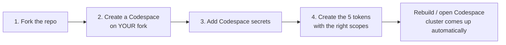

# Start the benchmark

This is the **front door** to the workshop. Follow it top to bottom and you go
from nothing to a running cluster with every token in place — without reading any
other page first. It is also the **single source of truth for secrets**: every
later module links back here instead of re-listing tokens.

The whole path is four steps:



You will need accounts on three services before you start:

- **GitHub** (free) — to fork and run the Codespace.
- **Dynatrace** — a tenant you can create tokens in. A free
  [Dynatrace trial](https://www.dynatrace.com/signup/) works.
- **DeepSeek** — for the LLM key that powers the agents
  ([platform.deepseek.com](https://platform.deepseek.com/)).

---

## 1. Fork the repo

Create your own copy of the workshop repository under your GitHub account.

1. Open the workshop repo:
   [`henrikrexed/dynatrace-AI-Agent-Workshop`](https://github.com/henrikrexed/dynatrace-AI-Agent-Workshop).
2. Click **Fork** (top-right) → **Create fork**. Keep the default name.

You now have `your-username/dynatrace-AI-Agent-Workshop`. Everything below
happens on **your fork**, never on the upstream repo.

!!! info "Why fork?"
    The published workshop site and the demo write-back (issues/PRs the BMAD crew
    creates) run against **your** repository. Working on a fork keeps your tokens,
    your Codespace secrets, and your GitHub Pages copy entirely under your own
    account.

New to forks? See GitHub's
[Fork a repo](https://docs.github.com/en/pull-requests/collaborating-with-pull-requests/working-with-forks/fork-a-repo)
guide.

---

## 2. Create a Codespace on your fork

The devcontainer installs the full toolchain (`kubectl`, `helm`, `kind`,
`kagent`, `uv`, `mkdocs`, …) and, on create, builds a local Kubernetes cluster
automatically.

1. On **your fork** (`your-username/dynatrace-AI-Agent-Workshop`), click
   **Code → Codespaces → Create codespace on `main`**.
   - Make sure the repository shown is your fork, **not** `henrikrexed/…`.
2. **Machine type:** choose **4-core / 16 GB** or larger. The default
   2-core / 4 GB is **not** enough for the full stack.

!!! tip "Set the secrets first (Step 3) — it saves a rebuild"
    Codespace secrets are injected at container start. If you create the
    Codespace before adding them, add the secrets, then run
    **Codespaces: Rebuild Container** so the values are picked up.

---

## 3. Add your Codespace secrets

Set the tokens from Step 4 as **Codespace secrets** so they are injected as
environment variables — never committed to git.

1. Go to GitHub **Settings → Codespaces → Secrets**
   ([github.com/settings/codespaces](https://github.com/settings/codespaces)),
   or your fork's **Settings → Secrets and variables → Codespaces** for a
   repo-scoped secret.
2. For each secret in the table below, click **New secret**, paste the value,
   and **scope it to your fork** (`your-username/dynatrace-AI-Agent-Workshop`).
3. After adding or rotating a secret, **rebuild or restart** the Codespace.

GitHub only prompts for the declared variables in the *Create codespace with
options…* dialog; you can also set them any time from the Codespaces secrets
page above. Reference: GitHub's
[account-specific Codespaces secrets](https://docs.github.com/en/codespaces/managing-your-codespaces/managing-your-account-specific-secrets-for-github-codespaces).

| Secret | Required | What it is |
|--------|:---:|---------|
| `DT_TENANT_URL` | ✅ | Dynatrace tenant URL, e.g. `https://abc12345.live.dynatrace.com`. |
| `DT_API_TOKEN` | ✅ | Dynatrace **OTLP ingest** token (`dt0c01`) — see token **A** below. |
| `DT_PLATFORM_TOKEN` | ✅ | Dynatrace **platform** token (`dt0s16`) for the SRE MCP + `dtctl` — token **B**. |
| `DYNATRACE_API_TOKEN` | ✅ | Dedicated **dt-evals** token (`dt0c01`) — token **C**. Distinct from `DT_API_TOKEN`. |
| `DEEPSEEK_API_KEY` | ✅ | DeepSeek LLM key powering the agents — token **D**. (Fallback var: `LLM_API_KEY`.) |
| `GH_PAT` | ✅ | GitHub fine-grained PAT for the demo write-back — token **E**. |
| `GH_DEMO_REPO` | ✅ | The demo repo the GitHub MCP writes to, as `owner/repo` (e.g. `your-username/bad-crew-demo`). |
| `DT_ENVIRONMENT` | optional | Dynatrace **apps** URL (`https://<env>.apps.dynatrace.com`). Derived from `DT_TENANT_URL` if unset. |

Verify presence once the Codespace is up (values are never printed):

```bash
bash .devcontainer/bootstrap/check-secrets.sh
```

---

## 4. Create the required tokens

Five credentials power the workshop. Create each one with **exactly** the
permissions below — over-scoping is a security risk, under-scoping breaks a
module.

### A. Dynatrace OTLP ingest token → `DT_API_TOKEN`

Used by the Dynatrace Operator and the OpenTelemetry collector to send the
agents' traces, metrics, and logs into Dynatrace.

- **Type:** API token, prefix `dt0c01`.
- **Scopes:** `openTelemetryTrace.ingest` · `metrics.ingest` · `logs.ingest`.
- **Create it:** in your Dynatrace environment, open **Access Tokens**
  (`https://<your-env>.apps.dynatrace.com/ui/apps/dynatrace.classic.tokens`) →
  **Generate new token** → select the three ingest scopes.
- **Docs:** [Dynatrace access tokens](https://docs.dynatrace.com/docs/manage/identity-access-management/access-tokens-and-oauth-clients/access-tokens).

### B. Dynatrace platform token → `DT_PLATFORM_TOKEN`

Used by the **Dynatrace MCP server** (the SRE agent's tools: problems, entities,
logs, metrics) and the `dtctl` CLI in the optimization module.

- **Type:** platform token, prefix `dt0s16`.
- **Create it:** at
  [**My platform tokens**](https://myaccount.dynatrace.com/platformTokens) →
  **Generate token**. The token inherits your user's platform permissions.
- **Docs:** [Dynatrace platform tokens](https://docs.dynatrace.com/docs/manage/identity-access-management/access-tokens-and-oauth-clients/platform-tokens).

!!! note "Platform ≠ OTLP"
    `DT_PLATFORM_TOKEN` (`dt0s16`) is **not** the same as `DT_API_TOKEN`
    (`dt0c01`). They authenticate against different Dynatrace surfaces — keep
    them separate.

### C. Dynatrace dt-evals token → `DYNATRACE_API_TOKEN`

Used by the **dt-evals** CLI to read agent spans and write evaluation results
back into Dynatrace. It is a **separate** `dt0c01` token from the OTLP one.

- **Type:** API token, prefix `dt0c01`.
- **Scopes:** `storage:spans:read` **and** `storage:events:write`.
- **Create it:** same **Access Tokens** page as token **A**, but select those
  two storage scopes.
- **Docs:** [Dynatrace access tokens](https://docs.dynatrace.com/docs/manage/identity-access-management/access-tokens-and-oauth-clients/access-tokens).

### D. LLM / DeepSeek API key → `DEEPSEEK_API_KEY`

Powers every kagent agent (DeepSeek is the cost-efficient default for the
workshop). DeepSeek's API is OpenAI-compatible.

- **Create it:** at
  [platform.deepseek.com/api_keys](https://platform.deepseek.com/api_keys) →
  **Create new API key**. Copy it immediately — DeepSeek shows it only once.
- **Docs:** [DeepSeek API docs](https://api-docs.deepseek.com/).

### E. GitHub fine-grained PAT → `GH_PAT`

Used by the **GitHub MCP** so the BMAD "bad crew" can open issues and pull
requests on your demo repo.

- **Type:** fine-grained personal access token, scoped to the **single** demo
  repo only (the one you set in `GH_DEMO_REPO`) — **not** all repositories, no
  org or admin access.
- **Repository permissions:**
  **Contents → Read and write** ·
  **Issues → Read and write** ·
  **Pull requests → Read and write**.
- **Create it:** at
  [github.com/settings/personal-access-tokens/new](https://github.com/settings/personal-access-tokens/new)
  (**Settings → Developer settings → Personal access tokens → Fine-grained
  tokens → Generate new token**) → under **Repository access** pick **Only
  select repositories** and choose your demo repo → set the three permissions
  above.
- **Docs:** [Creating a fine-grained PAT](https://docs.github.com/en/authentication/keeping-your-account-and-data-secure/managing-your-personal-access-tokens#creating-a-fine-grained-personal-access-token).

---

## 5. Confirm you're ready

Open (or rebuild) the Codespace. `postCreate` runs automatically and builds the
local cluster. When the terminal settles, verify:

```bash
bash .devcontainer/bootstrap/check-secrets.sh   # all required secrets present?
kubectl get nodes                                # a Ready node?
kubectl get namespaces                           # dynatrace, kagent, tetragon, phoenix, …?
```

A Ready node and the staged namespaces mean the benchmark is up. You're done
with onboarding.

## Next

- **[00 — Setup (Codespace)](00-setup.md)** — more on the devcontainer and
  re-running the bootstrap.
- **[01 — Platform install](01-platform-install.md)** — install the Dynatrace,
  OpenTelemetry, kagent, Tetragon, and Phoenix stack.

The full workshop flow then runs **01 → 07**. All five tokens above are
referenced from the modules that use them, which link back to this page.
