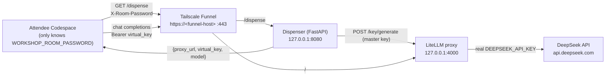

# Workshop LiteLLM proxy + key dispenser

Instructor-side infrastructure (ISI-6995 / [ISI-6992](https://github.com/henrikrexed/dynatrace-AI-Agent-Workshop) WS2) that lets workshop attendees reach DeepSeek **without ever holding the real DeepSeek key**. The real key lives only on a Proxmox LXC; attendees get a short-lived, budget-capped virtual key handed out by a password-gated dispenser over a Tailscale Funnel.

> **This directory contains sanitized templates only — zero secrets, zero environment-specific URLs.** All real values are injected on the LXC via `/etc/litellm/litellm.env` (see `litellm.env.example`).

## Architecture



- **Allowlist**: `config.yaml` exposes exactly one model, `deepseek-chat`. Any other model → HTTP 400. A leaked virtual key can reach nothing else.
- **Per-key budget**: each virtual key is minted with `max_budget=$4`; LiteLLM returns 429 once hit. Session ceiling ≈ **$240** (60 users × $4).
- **On-demand minting**: no pre-minted pool to exhaust; each valid `/dispense` call mints a fresh capped key.
- **Secrets**: `DEEPSEEK_API_KEY`, `LITELLM_MASTER_KEY`, `WORKSHOP_ROOM_PASSWORD`, `PROXY_PUBLIC_URL` live only in `/etc/litellm/litellm.env` (0600) on the LXC.

## Dispenser contract (§2 — stable; WS3/WS4 build against this)

```
GET https://<funnel-host>/dispense
  header:  X-Room-Password: <room password>
  200 ->   { "proxy_url": "https://<funnel-host>",
             "virtual_key": "sk-...",
             "model": "deepseek-chat" }
  401 ->   invalid or missing room password
```

Clients then use `proxy_url` as their OpenAI-compatible base URL and `virtual_key` as the bearer token, requesting model `deepseek-chat`.

## Files

| Path | Purpose |
|------|---------|
| `config.yaml` | LiteLLM config — the single-model allowlist. Safe to commit. |
| `litellm.env.example` | Secret-file template. Copy to `/etc/litellm/litellm.env` on the LXC and fill in. |
| `dispenser/app.py` | FastAPI dispenser (password → mint → `{proxy_url, virtual_key, model}`). |
| `dispenser/requirements.txt` | Dispenser Python deps. |
| `systemd/litellm.service` | Runs LiteLLM on `127.0.0.1:4000`. |
| `systemd/dispenser.service` | Runs the dispenser on `127.0.0.1:8080`. |
| `scripts/setup-postgres.sh` | One-time local PostgreSQL provisioning (LiteLLM requires it). |
| `scripts/deploy.sh` | Idempotent install/update on the LXC. |
| `scripts/rotate-password.sh` | Rotate the room password between sessions. |
| `scripts/revoke-all.sh` | Revoke every minted key between sessions. |
| `scripts/usage.sh` | Spend vs ceiling summary. |
| `scripts/teardown.sh` | Revoke → stop services → stop funnel. |

## Deploy (on the LXC, as root)

```bash
# 1. Copy this directory to the LXC
scp -r infra/litellm-proxy root@<lxc>:/opt/litellm/src

# 2. One-time: install + provision PostgreSQL (LiteLLM requires it)
ssh root@<lxc> 'apt-get install -y postgresql && bash /opt/litellm/src/scripts/setup-postgres.sh'
#    -> copy the DATABASE_URL it prints

# 3. First run creates /etc/litellm/litellm.env from the template
ssh root@<lxc> 'bash /opt/litellm/src/scripts/deploy.sh'

# 4. HUMAN-GATED: edit the secret file and set the real values
ssh root@<lxc> 'sudo "$EDITOR" /etc/litellm/litellm.env'
#    set: DEEPSEEK_API_KEY, LITELLM_MASTER_KEY, WORKSHOP_ROOM_PASSWORD,
#         PROXY_PUBLIC_URL, DATABASE_URL (from step 2)

# 5. Re-run deploy to pick up the secrets (idempotent — never clobbers the env file)
ssh root@<lxc> 'bash /opt/litellm/src/scripts/deploy.sh'
```

> The host also needs `python3.11-venv` (`apt-get install -y python3.11-venv`) for `deploy.sh` to build the virtualenv.

### Tailscale Funnel paths

The funnel must route two paths to the two local services:

```bash
tailscale funnel --bg --set-path=/dispense http://127.0.0.1:8080   # dispenser
tailscale funnel --bg http://127.0.0.1:4000                        # proxy at /
```

## Per-session ops

```bash
bash scripts/rotate-password.sh        # before each session — new room password
bash scripts/usage.sh                  # during — watch spend vs $240 ceiling
bash scripts/revoke-all.sh             # between the two sessions — reset budget
```

## Teardown

```bash
bash scripts/teardown.sh               # revoke keys, stop services + funnel
# then, from a Proxmox node:
pct stop <CTID> && pct destroy <CTID>
```

## Notes

- **DB engine**: the approved design uses SQLite (`DATABASE_URL=sqlite:////var/lib/litellm/litellm.db`) to keep the LXC dependency-free. LiteLLM's virtual-key store runs on Prisma; `deploy.sh` installs `prisma` and LiteLLM runs the migrations on first boot. If a future LiteLLM release drops SQLite support for key management, switch `DATABASE_URL` to a local Postgres — no other change is needed.
- **Nothing here is environment-specific**: the funnel host, room password, and keys are all runtime env. The repo pins no URL.
